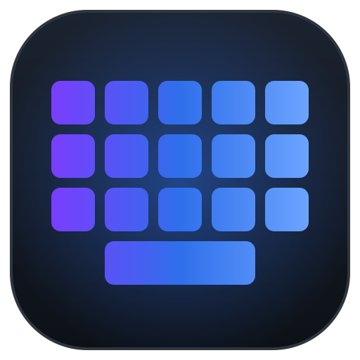

# Legion Light

Keyboard backlight control for the Lenovo Legion 5 15AHP11 (`83Q7`, USB
`048d:c615`), in Rust with an optional GPUI desktop app.

The laptop's firmware confirms **one RGB zone**. Static colour and brightness
have been confirmed in both the diagnostic command and the GUI. Effects and
profile encodings come from Lenovo's Windows installer; see
[installer evidence](docs/installer-analysis.md).

## Install with Flatpak

Requires [Flatpak](https://flatpak.org/setup/) with the Flathub remote (for the
runtime). Add the Legion Light repository, then install and run:

```bash
flatpak remote-add --user --if-not-exists legionlight \
  https://kestermckinney.gitlab.io/legionlight/flatpak/legionlight.flatpakrepo
flatpak install --user legionlight io.gitlab.kestermckinney.LegionLight
flatpak run io.gitlab.kestermckinney.LegionLight
```

Update with `flatpak update`. Or install the `LegionLight.flatpak` bundle from the
latest release with `flatpak install --user LegionLight.flatpak`.

The Flatpak cannot grant itself access to the keyboard. Install the udev rule on the
host once, then reconnect the keyboard or reboot (see [Device access](#device-access)):

```bash
curl -O https://gitlab.com/kestermckinney/legionlight/-/raw/main/packaging/70-legionlight.rules
sudo install -m644 70-legionlight.rules /etc/udev/rules.d/
sudo udevadm control --reload && sudo udevadm trigger
```

## Build and run

```bash
cargo test
cargo test --features gui-tests --bin legion_light
cargo build --features gui --bin legion_light --bin legion_light_ctl
cargo run --features gui --bin legion_light
```

The app opens at **640 × 640**, with a minimum of 560 × 480. It follows
SeeMyMac's design handoff: Inter where installed, 13 px text, 32 px controls,
dark surfaces, blue focus outlines, and a GNOME-style draggable header with
minimize, maximize, and **Exit**. Content scrolls inside the window. Ctrl+Q exits.

Opening the app, changing profile tabs, and loading saved drafts perform no
lighting writes. Applying a colour/effect or brightness sends a debounced update
to the selected profile. **Apply profile** also activates its current draft.
Brightness is shared by the physical keyboard; the active draft's value is sent.

## Colours and effects

- **Static:** one chosen colour.
- **Breathe:** Lenovo's colour-pulse effect with one chosen colour.
- **Lenovo colours:** native pulse using the built-in changing-colour palette.
- **Custom palette:** app-driven smooth pulses through 2–4 chosen colours.
- **Off:** saves the selected GUI profile as an off profile.

Animated effects offer Slow / Normal / Fast. Normal retains Lenovo's default
speed value 2 for native effects. Static, Breathe, and Lenovo colours run in
firmware after the app exits. **Custom palette needs the app running** (it may
be minimized). Its LampArray player has been visually verified to fade through
red, green, and blue; it sends transient colour updates rather than repeated
saved-profile writes.

The keyboard stores custom colour lists but only plays their first entry through
the native pulse command. Custom profiles therefore save their **first colour as
a steady firmware fallback**. Closing the app restores that colour and firmware
control. Fn+Space alone cannot replay the full custom palette; it needs the app.
Changing the native profile with Fn+Space stops live playback when the firmware
selection change is detected. Exit and the normal window-close action wait for
control restoration before quitting. No ownership probe, administrator helper,
or ACPI setting is needed for playback.

Choose a swatch, or enter a hex colour (`#FF8000`) or RGB (`255,128,0`) and press
Enter or **Set colour**. The field supports select all, copy/cut/paste, cursor
movement, Home/End, Backspace/Delete, and Escape to cancel. Tab focuses it.
For Custom palette, select an entry before changing its colour; **+** and
**Remove** keep the list within 2–4 entries.

The Windows code advertises only off, static, and colour-pulse for this OneZone
model. Wave, ripple, rain, audio and typing effects in the shared Windows library
are not advertised for this keyboard and are not exposed here.

## Fn+Space profiles and saved drafts

Each of the three **Profile** tabs edits its own draft. Each draft can hold any
supported effect, its colours, and speed; custom palettes use the steady
first-colour fallback in the firmware slot. Tabs alone do not select a firmware
profile. Ordinary edits and Apply profile save/activate the selected slot.
**Save Fn+Space profiles** writes all three drafts and activates the selected
one. The firmware hotkey then cycles those stored profiles (including custom-palette
fallback colours). The selected custom palette starts app playback after saving.

**Lenovo defaults** restores the shipped arrangement and activates profile 2:

1. Native changing-colour pulse, speed 2.
2. Static purple (`#5805FF`).
3. Off.

This action replaces all three stored slots, at the shipped brightness 7.

**Save to disk** atomically stores all three drafts and the selected tab.
**Load from disk** restores the drafts without applying them. Saved drafts also
load at startup without applying them. The path is
`$XDG_CONFIG_HOME/legionlight/presets/saved.json`, or under `~/.config` when that
variable is unset. Older single-profile and 24-zone presets are accepted: their
first colour loads into profile 2. New saves preserve all effects and palettes.

## CLI

```bash
# Device information and diagnostics.
cargo run --bin legion_light_ctl -- doctor
cargo run --bin legion_light_ctl -- probe

# Preview static red reports without writing anything.
cargo run --bin legion_light_ctl -- apply --all 255,0,0 --brightness 7

# Apply static red to profile 2.
cargo run --bin legion_light_ctl -- apply --all 255,0,0 --brightness 7 --write

# Dim the current profile without replacing its saved effect.
cargo run --bin legion_light_ctl -- off --write
```

The CLI remains a static-colour/diagnostic tool; use the GUI for effects, custom
palettes, and three-profile editing. The only zone is 1. Writes require `--write`.
`clear --write` explicitly empties profile 2; it is separate from normal CLI off.
Device identity and the HID lighting descriptor are checked before writes.
Control reports are separated by 150 ms as in Lenovo's transport.

## Device access

The app uses the desktop user's hidraw access and does not elevate privileges.
The packaged `packaging/70-legionlight.rules` grants active-seat access. Where
needed, install it under `/etc/udev/rules.d/`, reload rules, and reconnect or
reboot. Remove the older broad `60-legionaura.rules` when replacing that setup.

The original static diagnostic remains available:

```bash
python3 docs/installer-evidence/onezone-ctl.py FF0000 --brightness 7
```

It saves before/after query reports under `/tmp/legion-onezone-set-*`.

## Source and verification

- `src/model.rs`: colours, effects, three-slot drafts, preset compatibility.
- `src/lighting/protocol.rs`: recovered OneZone profile encoder.
- `src/lighting/hid.rs`: identity checks and HID transport.
- `src/lighting/worker.rs`: debounced serial writes and graceful shutdown.
- `src/lighting/palette.rs`: transient LampArray player and firmware restoration.
- `src/app.rs`, `src/view.rs`: desktop controls.
- `src/ui_tests.rs`: headless interface tests with a disconnected worker.
- `src/bin/legion_light_ctl.rs`: static CLI and diagnostics.

Unit tests check static packets, native animated encodings, palette fallbacks,
all-colour playback and wraparound, brightness scaling, individual slots, off
profiles, and preset migration. UI tests
check compact-window layout, Exit, text entry, and independent palette drafts.
They do not send HID reports. Suspend/resume reapplication is not implemented.

[Protocol notes](docs/protocol-notes.md) and [design notes](DESIGN.md) retain the
investigation history, including earlier assumptions disproved by the firmware
and visual tests. Use the current installer evidence and encoder for this model.
